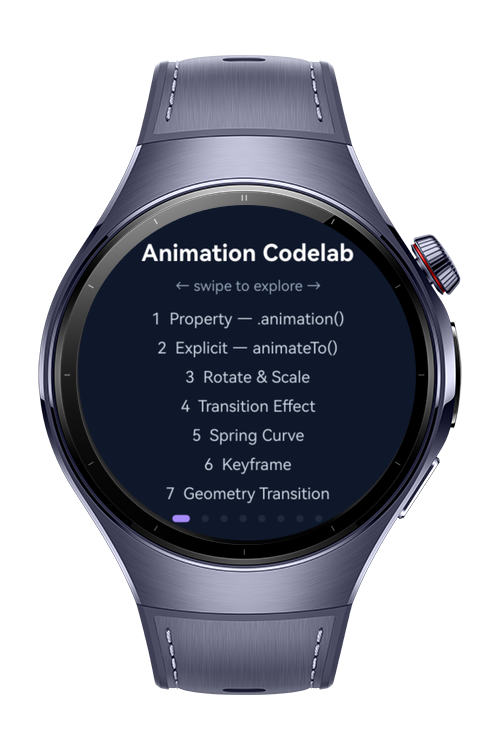
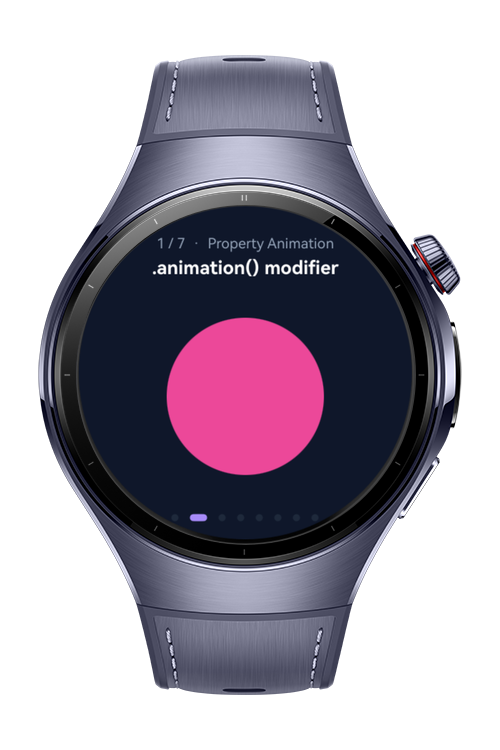
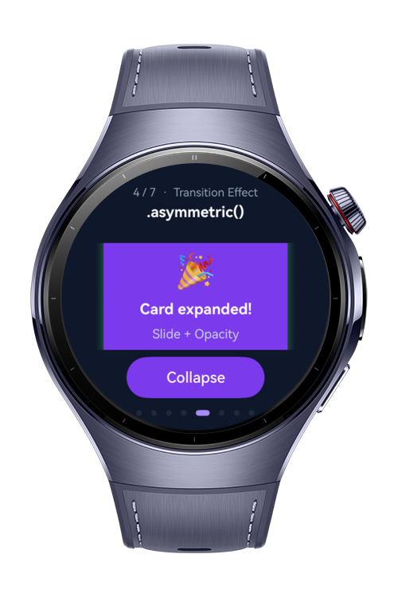

> **Note:** To access all shared projects, get information about environment setup, and view other guides, please visit [Explore-In-HMOS-Wearable Index](https://github.com/Explore-In-HMOS-Wearable/hmos-index).

# How to Use Animation

This codelab aims to provide an introduction to using animations in ArkTS.It demonstrates how to create smooth and interactive UI animations, 
explains the basic animation APIs, and helps developers understand how to enhance the user experience with animation effects.

# Preview

<div>
  
  
  
</div>

# Use Cases
- Learn how to use animation in ArkTS

# Technology

## Stack
- **Languages**: ArkTS, ArkUI
- **Frameworks**: HarmonyOS SDK 5.1.0(18)
- **Tools**: DevEco Studio Version 6.0.0
- **Libraries**:
    - `@kit.ArkUI`

## Required Permissions
- 

# Directory Structure

```
entry/
├── src/main/ets/
│ │
│ ├── entryability/
│ │ └── EntryAbility.ets
│ │
│ ├── entrybackupability/
│ │ └── EntryBackupAbility.ets
│ │
│ ├── pages/
│ │ └── Index.ets
```

# Constraints and Restrictions

## Supported Devices

* Huawei Watch 5

* Huawei Ultimate 2

* DevEco Studio Emulator

# License (MIT)

**How to Use Animation** is distributed under the terms of the MIT License. See the [LICENSE](../../../LICENSE) for more information